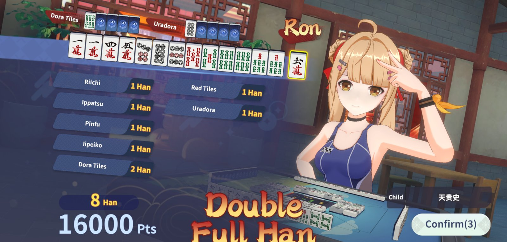
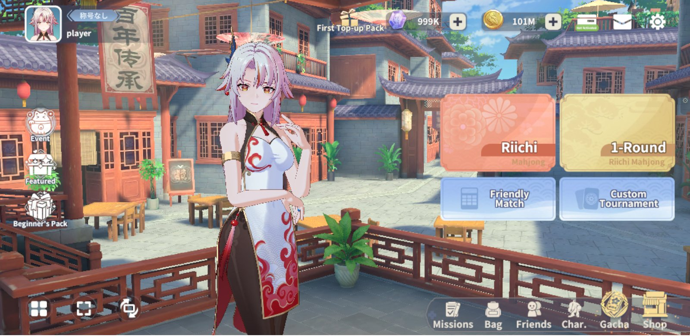
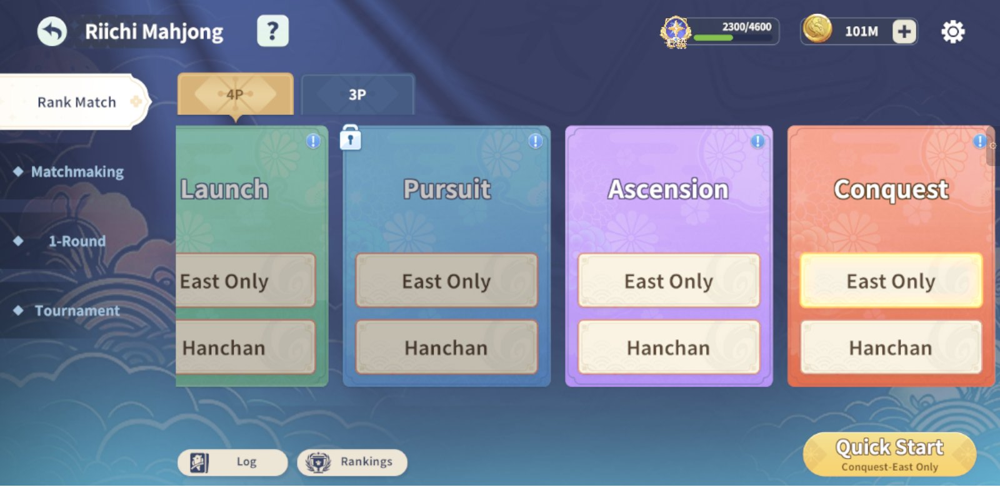
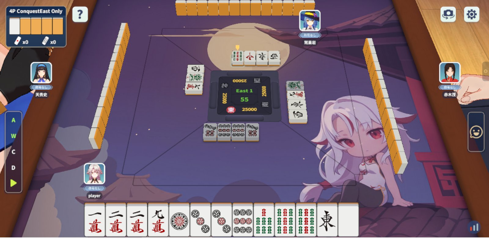
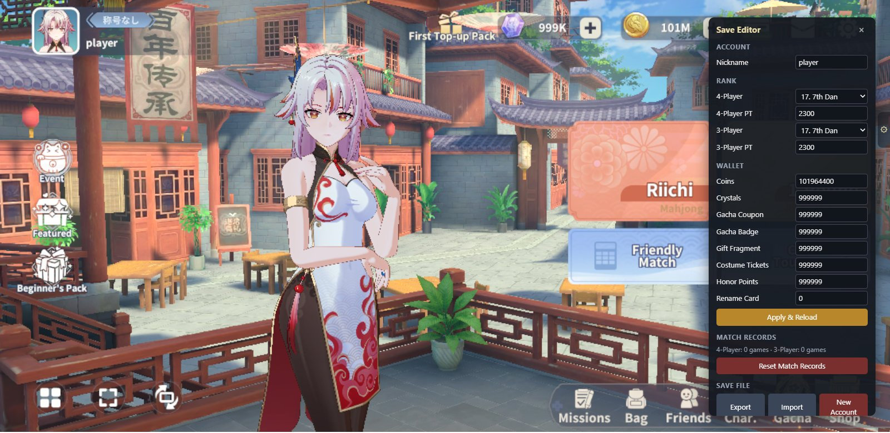

# 激情麻将 · 离线立直麻将

[English](README.md)

**《激情麻将 / 雀梦麻将》（Mahjong Dream）已于 2026 年 10 月关服。这个项目让它以单机立直麻将的形式继续运行：免费、无需注册，打开浏览器就能玩。**

原版 3D 二次元客户端、角色、语音和对局演出都保留了下来。原来的在线服务换成在你自己电脑上运行的本地后端：对手是 AI，没有账号，也不用花一分钱。



<p align="center"><em>AI 也会打出大牌：8 番倍满，一发荣和 16000 点。</em></p>

## ▶ 马上开玩

**用 Chrome 或 Edge 打开 <https://mahjong-dream.pages.dev>**，无需安装或注册。

- 首次加载约 30 MB，牌桌资源会在游戏中按需下载；浏览器缓存后再次打开会更快。
- 默认显示英文，可在 ⚙ Settings → Language 切换为简体中文等语言，游戏会记住你的选择。
- 推荐使用电脑横屏游玩。

## 有什么好玩的

- 🀄 **正统日麻**：支持四麻、三麻的东风战和半庄战，还有一局决胜负的**一局战**。规则参照雀魂段位战，役种和役满齐全，振听、途中流局、流局满贯、包牌和符数计算都很严谨。
- 🎎 **开局全解锁**：10 位雀士、19 套服装、满级好感（Lv.6 MAX），以及全部头像、称号、桌布、牌背、立直音乐和和牌特效，一开始就能用。
- 🤖 **不作弊的 AI**：19 位对手各有名字、造型和打法，有猛攻的，也有稳守的。三档难度分布在四个段位房间，最强的 AI 会根据牌河、摸切和立直时机读牌防守。所有 AI 只看公开信息，绝不偷看牌山和你的手牌。
- 🏆 **段位冲分**：启航 → 逐梦 → 乘风 → 御龙，段位 PT、升降段和战绩都和原版一样。
- 🛍️ **商店能用**：四个商店都能正常购买，开局就有充足的雀币和梦石，随便花。
- 🛠️ **自带存档修改器**：段位、金币、昵称想改就改，也能重置战绩、备份存档。单机游戏，你说了算。
- 🔒 **隐私安全**：不上传任何数据，没有广告，也没有追踪。网站只负责下发游戏文件。

## 游戏截图

| 大厅 | 段位房间 |
| --- | --- |
|  |  |
| **对局中** | **存档修改器** |
|  |  |

## 你的存档

- **网页版**：进度保存在当前浏览器里。清除网站数据、用无痕窗口、换浏览器或换设备都会变成一份新存档，**记得定期导出备份**。
- **存档修改器**：点游戏**右侧边缘的 ⚙ 小标签**打开。
  - **Account / Rank / Wallet**：修改昵称、四麻/三麻段位和 PT、雀币、梦石、各类券，然后点 **Apply & Reload**。
  - **Reset Match Records**：清空战绩，段位和钱包保留。
  - **Export / Import**：把存档导出成 JSON 文件，或从文件导入。离线版也能读取同一个文件。
  - **New Account**：从头开始。
  - 对局进行中不能修改，请先打完或退出对局。
- 网页版在对局中途刷新，会结束这一局，但存档保留；下面的离线版刷新后可以接着打。

## 离线版（Windows）

想完全在本机运行，不用打开网站，也可以：

1. 安装 **[Node.js](https://nodejs.org/) 22 或更高版本**。
2. 下载本仓库（Code → Download ZIP）并解压。
3. 双击 **`start-game.bat`**。它会自动准备环境，在 `http://127.0.0.1:8765/` 启动游戏，并打开 Edge 或 Chrome。
4. 关闭黑色命令行窗口即可退出。

离线版存档在 `userdata/profile.json`，复制这个文件就能备份。网页版和离线版之间可以用修改器的 Export / Import 互相转移存档。

如果想直接进入指定模式，可以加上参数：

```bat
start-game.bat --players=4 --length=hanchan
start-game.bat --players=3 --length=east
```

### 和牌结算动画演示

想直接看某一档的和牌动画，不用苦等？双击 **`demo-settlement.bat`**，选满贯、跳满、倍满、三倍满、役满或依次轮播（也可以直接运行 `demo-settlement.bat baiman`）。它会用一次性的浏览器配置单独开一个窗口，自动进入四麻对局并由 AI 替你打牌；之后每次和牌都按所选档位结算，播放完整动画。对局不会结束，关掉窗口即可退出。番数、役种和点数是固定示例，与画面上的手牌不对应。不会动你的存档。需要 Node.js 22 和 Edge 或 Chrome。

## 调试日志

断线提示上可点 **Export diagnostics**（导出诊断日志）；正常运行时也可在浏览器开发者控制台执行 `__mjmock.exportLogs()`。日志只留本地，包含计时生命周期、请求结果、连接/同步过程和前端异常。浏览器历史有容量上限，出问题后请及时导出；离线启动器还会把服务端日志写入 `logs/`。默认不写成功心跳、空鸣牌收尾、AI 计算、历史重演细节和 Unity/SDK 普通杂讯，保留实际操作、计时结算/超时、断线同步和未知警告/错误；导出不重复附加已落盘的页面行。需要细节时，Node 后端设置 `MJ_DEBUG=1`；页面与静态后端在网址加 `mjDebug=1`，仅本地记录、不上传远端。

倒计时由本地后端统一管理：每小局（含连庄）庄家首手 8＋20 秒，前台等手牌可操作、绘制完成后起表；其他决策为 5 秒＋剩余共享备用。备用耗尽只显示白色基础倒计时 5，不显示 5＋0；备用阶段为黄色。后台照常推进、返回不主动重连；真实断线才冻结。新页面先恢复进桌再重放，同页可用快照；都须等 Unity 实际消费确认后续时。当前国际版通过保留原件的哈希固定派生客户端实现。受控 Edge 已验证双宿主关闭重开，系统级挂起、自然抢杠/抢北与移动端仍未完整验收。详见[当前交接状态](docs/handoff.md)。

## 常见问题

**黑屏或卡在加载中？** 请使用较新的 Chrome 或 Edge，打开硬件加速后刷新页面。首次加载需要稳定的网络。

**能和朋友联机吗？** 不能，这是和 AI 对战的单机游戏。好友、抽卡、公会、比赛等入口会提示离线不可用。

**有四川麻将、斗地主或掼蛋吗？** 没有，目前只支持立直麻将。

## 自己部署一份

Fork 本仓库，然后在 Cloudflare 用它新建一个 **Pages** 项目：不填构建命令，输出目录留空，并添加环境变量 `SKIP_DEPENDENCY_INSTALL=true`。仓库自带的 `_headers` 能让浏览器原生解压游戏文件，并缓存资源包。也可以用 GitHub Pages（**Settings → Pages → `main` / root**）或任意静态文件服务器，支持子路径，但加载会慢一些。

## 开发者

```bash
npm install
npm run check   # 语法检查
npm test        # 回归测试
npm run build   # 由 mockjs/ 重新生成 mock/riichi.js
```

- 网页版与离线版共用同一后端：[ADR 0007](docs/adr/0007-browser-and-node-hosts.md)
- 架构：[`docs/technical-architecture.md`](docs/technical-architecture.md) · 代码地图：[`codemap.md`](codemap.md)
- 规则基线：[ADR 0002](docs/adr/0002-use-mahjong-soul-ranked-rules.md) · AI 分级：[ADR 0006](docs/adr/0006-riichi-ai-levels.md) · NPC 与对局恢复：[ADR 0008](docs/adr/0008-npc-roster-and-match-recovery.md) · 倒计时桥接（哈希固定的派生 Unity WASM）：[ADR 0009](docs/adr/0009-derived-unity-clock-client.md) · 英文结算档位贴图（派生资源包）：[ADR 0010](docs/adr/0010-derived-settlement-titles.md)
- 历史记录：[`docs/handoff.md`](docs/handoff.md)、[`docs/repair-backlog.md`](docs/repair-backlog.md)

<details>
<summary>完整规则与 AI 说明</summary>

**模式**

- 四人立直：东风战和半庄战；段位房间为启航、逐梦、乘风、御龙。
- 三人立直：东风战和半庄战；有拔北宝牌，去掉二至八万，北风算役牌，采用自摸损。
- 一局战：一局决胜负，分铜、银、金、玉四档，按番数发放奖励。

**规则**

- 役种：立直、双立直、一发、门清自摸、断幺、平和、一杯口、三色同顺、一气通贯、混全带幺九、纯全带幺九、混一色、清一色、七对子、对对和、三暗刻，以及全部役满和双倍役满。
- 途中流局：九种九牌、四风连打、四家立直、四杠散了（第四杠的岭上摸牌和打牌都无人荣和后才成立）、流局满贯。
- 振听：舍牌振听、同巡振听（包括无役见逃，摸牌后解除）、立直后的永久振听。
- 计分：连风雀头 4 符；嵌张、边张和单骑 2 符；平和自摸 20 符；七对子 25 符；包牌、立直棒、本场和和了止也都正确处理。

**AI**

- 低级（启航、逐梦）：处理合法动作、牌效、打点和基础防守。
- 中级（乘风、一局战，默认）：按期望值综合考虑向听、受入、打点、现物/筋/壁的危险度和押引；吃、碰前会和不鸣的期望值比较。
- 高级（御龙）：增加限定计算量的听牌搜索和精确打点估算；根据公开的牌河、摸切、立直和副露判断各家的听牌概率与危险度；All Last 会按顺位调整打法。
- 固定随机种子时，对局完全可复现。

**对手**：19 位 NPC，名字致敬知名麻将角色（Saki、Nodoka、Koromo、Awai、Akagi 等）。每人有固定的角色和服装，打法也各不相同：押得多狠、爱不爱鸣牌、立直还是默听、求快还是做大。强弱仍由房间决定。

**中途离开**：关闭或刷新页面后，对局会停在你的回合等你。5 分钟内回来可以接着打；超过 5 分钟，下次打开游戏时由 AI 替你打完，成绩照常计入。

</details>

---

*粉丝自制的保存项目，与原开发商、发行商无关；原始 Unity 客户端文件保留不动，另用哈希固定的派生 WASM 同步倒计时（ADR 0009），并用派生资源包把英文结算档位改为 Mangan/Haneman/Baiman/Sanbaiman（ADR 0010）。*
